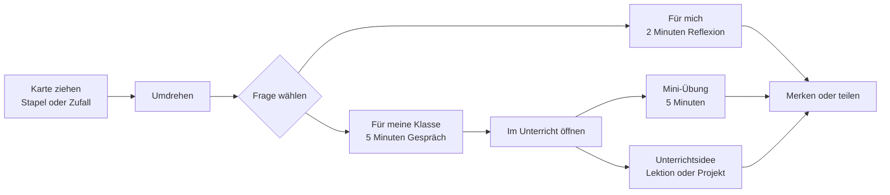

# Konzept: Inner Development Guide im Schulalltag

Stand: 21. September 2026 · Marc Widmer

## Auf einen Blick

Der Inner Development Guide im Schulalltag macht die 25 Kompetenzen des Inner Development Guide 2.0 als digitale Reflexionskarten für Lehrpersonen nutzbar. Jede Karte trägt vorne Name und Beschreibung der Kompetenz aus dem Rahmenwerk, hinten Reflexionsfragen für die Lehrperson und für die Klasse, Unterrichtsideen, Anknüpfungspunkte an die Fachbereiche und eine Mini-Übung von rund fünf Minuten.

Das Angebot ist unentgeltlich, braucht kein Konto, läuft offline und speichert Daten nur lokal im Browser. Es ergänzt die Zukunftskompetenz-Challenge, ist vom Inner Development Guide inspiriert und kein offizielles Produkt der Herausgeber:innen.

| Merkmal | Ausprägung |
| --- | --- |
| Adresse | [guide.zukunftskompetenzchallenge.ch](https://guide.zukunftskompetenzchallenge.ch/) |
| Form | Landingpage mit umdrehbarem Kartenstapel und installierbare Web-App «IDG Guide für Lehrpersonen» |
| Umfang | 5 Dimensionen, 25 Kompetenzen, eine Karte pro Kompetenz |
| Sprachen | Deutsch, Englisch, Französisch, Italienisch, Spanisch, Schwedisch |
| Zielgruppe | Lehrpersonen, vor allem Volksschule Schweiz; Deutsch mit Bezug zum Lehrplan 21 |
| Kosten | unentgeltlich, ohne Konto |
| Datenschutz | keine Personendaten, keine Cookies, anonyme Nutzungsstatistik |

## Ausgangslage

Der Inner Development Guide 2.0 (Version 7.2) beschreibt 25 innere Fähigkeiten in fünf Dimensionen, die Menschen brauchen, um Wandel zu gestalten: Sein, Denken, Beziehungen, Zusammenarbeit und Handeln. Das Rahmenwerk stammt aus der Initiative [Inner Development Goals](https://innerdevelopmentgoals.org) und liegt in eigenständigen Ausgaben je Sprache vor.

Für Schulen ist das Rahmenwerk anschlussfähig. Der Lehrplan 21 verlangt überfachliche Kompetenzen und Bildung für Nachhaltige Entwicklung, und viele Kompetenzen des Guide decken sich damit. Der Guide bleibt aber eine Beschreibung: Er sagt, was Präsenz oder systemisches Denken bedeuten, nicht, wie eine Lehrperson das am Dienstagmorgen in der fünften Klasse aufgreift.

Diese Lücke füllt das Angebot. Es übersetzt jede Kompetenz in eine Karte mit Fragen, Ideen und einer Übung, die ohne Vorbereitung im Unterricht funktionieren. Es knüpft an die [Zukunftskompetenz-Challenge](https://zukunftskompetenzchallenge.ch) an, einen kostenlosen sechswöchigen E-Mail-Kurs für Lehrpersonen zu Zukunftskompetenzen, BNE, Lehrplan 21 und Inner Development Goals, und gibt den Teilnehmenden ein Werkzeug für den Alltag nach dem Kurs.

## Zielgruppen

Primäre Zielgruppe sind Lehrpersonen der Volksschule und der Sekundarstufe II in der Schweiz, die überfachliche Kompetenzen in ihren Unterricht holen wollen, ohne zusätzliche Vorbereitungszeit. Die App nennt als Stufe Zyklus 1 bis 3 und Sek II. Die Fragen für die Klasse sind so formuliert, dass sie sich für jüngere Kinder vereinfachen und für Jugendliche vertiefen lassen.

| Zielgruppe | Nutzen | Zugang |
| --- | --- | --- |
| Lehrpersonen Zyklus 1 bis 3 und Sek II | Reflexion für sich, Fragen und Übungen für die Klasse | App auf dem eigenen Gerät, Karte des Tages |
| Teilnehmende der Zukunftskompetenz-Challenge | Werkzeug, um die Kursinhalte im Alltag weiterzuführen | Link aus dem Kurs |
| Klassen | Reflexionsfragen und Mini-Übungen, angeleitet durch die Lehrperson | Karte projiziert oder vorgelesen |
| Kollegien und Schulleitungen | Gemeinsame Sprache für Haltung und Schulkultur, Impuls für Sitzungen und Weiterbildungstage | Karte per Deep-Link geteilt |
| Dozierende in Aus- und Weiterbildung | Beispielmaterial, wie sich das Rahmenwerk in Unterricht übersetzt | Kompetenzseiten mit vollem Karteninhalt |
| Lehrpersonen ausserhalb der Schweiz | Karten in fünf weiteren Sprachen mit verallgemeinerten Fachbezügen | Sprachfassungen der Website |

## Ziele und Wirkung

Das Versprechen steht im Titel der Landingpage: «Zukunft gestalten. In fünf Minuten.» Dahinter stehen drei Ziele, in dieser Reihenfolge:

1. **Lehrpersonen reflektieren die eigene Haltung.** Zwei Fragen pro Karte richten sich an die Lehrperson selbst: für die Vorbereitung am Morgen, den Heimweg oder das Gespräch im Team. Die Kompetenz beginnt bei der Person, die unterrichtet.
2. **Überfachliche Kompetenzen kommen regelmässig in den Unterricht.** Nicht als Zusatzfach, sondern als Einstieg in eine Lektion oder Klassenstunde, in fünf Minuten und ohne Vorbereitung. Ziel ist Regelmässigkeit, nicht Vollständigkeit.
3. **Der Inner Development Guide wird in Schulen bekannt und anschlussfähig.** Lehrpersonen lernen das Rahmenwerk über konkrete Fragen kennen, nicht über Theorie. Der Bezug zum Lehrplan 21 zeigt, dass es dafür keinen zusätzlichen Lehrplan braucht.

| Ebene | Angestrebte Veränderung | Sichtbar an |
| --- | --- | --- |
| Lehrperson | Bewusstere Entscheidungen im Klassenzimmer, eine Sprache für die eigene Haltung | Wiederkehrende Nutzung, gefüllte Merkliste, geteilte Karten |
| Klasse | Gesprächskultur, in der Fragen nach Werten, Perspektiven und Gefühlen normal sind | Mini-Übungen werden zu Ritualen, etwa die Stille Minute oder der Gefühls-Check-in |
| Schule | Gemeinsame Begriffe für Schulkultur und Zusammenarbeit im Kollegium | Einsatz in Sitzungen und an Weiterbildungstagen |

Das Angebot ersetzt weder Lehrplan noch Weiterbildung. Die Karten sind Impulse; ob eine Frage oder Übung in die Klasse passt, entscheidet die Lehrperson.

## Das Angebot im Überblick

Das Angebot besteht aus zwei Einstiegen unter einer Adresse. Die Landingpage erklärt und zeigt das Produkt, die App ist das Produkt.

| Einstieg | Pfad | Inhalt |
| --- | --- | --- |
| Landingpage | `/` | Hero mit echtem, umdrehbarem Stapel aus fünf Karten (eine je Dimension), Kartenanatomie am Beispiel «Selbsterkenntnis», die fünf Dimensionen, Nutzung im Schulalltag, Installationshinweis |
| App «IDG Guide für Lehrpersonen» | `/app/` | Alle 25 Karten als Stapel, Dimensionen, Merkliste, Einstellungen; installierbar, offline |
| Dimensions- und Kompetenzseiten | `/dimensionen/…`, `/kompetenzen/…` | Voller Karteninhalt als lesbare Seite, verlinkt in die App auf genau diese Karte |
| Projekt, Kontakt, Rechtliches | `/projekt/`, `/kontakt/`, `/datenschutz/`, `/nutzungsbedingungen/` | Hintergrund mit FAQ, E-Mail-Kontakt, Datenschutzerklärung, Nutzungsbedingungen |
| Sprachfassungen | `/en/`, `/fr/`, `/it/`, `/es/`, `/sv/` | Website und Karten in der jeweiligen Sprache, Deutsch ohne Präfix |

### Fünf Dimensionen, 25 Kompetenzen

Die Struktur folgt dem Inner Development Guide 2.0. Jede Dimension hat eine eigene Farbe, die die Karte von weitem erkennbar macht.

| Dimension | Untertitel | Kompetenzen |
| --- | --- | --- |
| Sein | Unser inneres Leben kultivieren | Innerer Kompass · Integrität und Authentizität · Offenheit und Lernbereitschaft · Selbsterkenntnis · Präsenz |
| Denken | Unsere komplexe Welt verstehen | Kritisches Denken · Perspektivische Fähigkeiten · Systemisches Denken · Langfristige Orientierung und Visionen · Kreativität |
| Beziehungen | Fürsorge für andere und die Welt | Wertschätzung · Verbundenheit · Demut und Bescheidenheit · Empathie und Mitgefühl · Vergebung |
| Zusammenarbeit | Vertrauen aufbauen und zusammenarbeiten | Beziehungen aufbauen · Inklusive Denkweise und interkulturelle Kompetenz · Gemeinsam Gestalten · Kommunizieren · Mobilisieren |
| Handeln | Veränderungen einleiten und ermöglichen | Mut · Hoffnung und Optimismus · Bewusster Umgang mit Ressourcen · Proaktiv Handeln · Resilienz |

### Aufbau einer Karte

Eine Karte, zwei Seiten, und dahinter das Material für die Lektion. Die Vorderseite trägt das Rahmenwerk, die Rückseite die Pädagogik.

| Teil | Inhalt | Herkunft |
| --- | --- | --- |
| Vorderseite | Dimension, Glyphe der Kompetenz in der Dimensionsfarbe, Name und Beschreibung | Wörtlich aus der Ausgabe des Inner Development Guide 2.0 in der jeweiligen Sprache |
| Rückseite «Für mich» | Zwei Reflexionsfragen an die Lehrperson | Für dieses Angebot geschrieben |
| Rückseite «Für meine Klasse» | Zwei Fragen, die unverändert in die Runde gehen können | Für dieses Angebot geschrieben |
| «Im Unterricht» | Zwei Unterrichtsideen, Anknüpfungspunkte an Fachbereiche, Mini-Übung mit Titel und Ablauf für rund fünf Minuten | Für dieses Angebot geschrieben, Deutsch mit Fachbereichen des Lehrplans 21 |

## Pädagogisches Konzept

Die Karten arbeiten mit Fragen, nicht mit Lehrsätzen. Eine Kompetenz wie Präsenz wird nicht erklärt, sondern in eine Situation im Klassenzimmer geholt: «Wann habe ich einer Schülerin, einem Schüler heute wirklich zugehört, ohne die Antwort schon zu kennen?»

### Sechs Prinzipien

1. **Bei der Lehrperson beginnen.** Jede Karte stellt zuerst zwei Fragen an die Lehrperson selbst. Wer die eigene Haltung reflektiert, gibt Fragen glaubwürdiger an die Klasse weiter.
2. **Fragen, die unverändert in die Runde gehen.** Die Klassenfragen sind kurz, offen und ohne richtig oder falsch: «Woher weisst du, dass das stimmt?» Sie brauchen keine Aufbereitung durch die Lehrperson.
3. **Drei Tiefen, frei wählbar.** Eine Frage füllt fünf Minuten. Die Mini-Übung füllt fünf Minuten mit Ablauf. Die Unterrichtsideen tragen eine Lektion oder ein Projekt. Die Lehrperson entscheidet, wie weit sie geht.
4. **An bestehenden Unterricht anknüpfen.** Jede Karte nennt Fachbereiche des Lehrplans 21, in denen die Kompetenz ohnehin Platz hat: Kritisches Denken in Medien und Informatik, Systemisches Denken in Natur, Mensch, Gesellschaft, Innerer Kompass in Ethik, Religionen, Gemeinschaft. Die Karten schaffen kein Zusatzfach.
5. **Ritualfähig und materialfrei.** Die Mini-Übungen brauchen weder Kopien noch Geräte und lassen sich wiederholen: die Stille Minute nach der Pause, das Innenwetter zu Lektionsbeginn, die Frage «Und dann?» im Kreis. Teilen ist immer freiwillig.
6. **Rahmenwerk und Pädagogik getrennt halten.** Namen und Beschreibungen der Kompetenzen stehen wörtlich aus dem Guide auf der Karte. Alles Weitere ist eigens geschrieben und als solches ausgewiesen. So bleibt nachvollziehbar, was Rahmenwerk ist und was Interpretation.

### Beispiel: Selbsterkenntnis

| Ebene | Inhalt der Karte |
| --- | --- |
| Für mich | Welche Situationen im Unterricht bringen mich aus dem Gleichgewicht, und was steckt dahinter? Wie reagiere ich unter Stress, und was nimmt meine Klasse davon wahr? |
| Für meine Klasse | Woran merkst du in deinem Körper, dass du wütend oder nervös wirst? Was kannst du gut, und woher weisst du das? |
| Im Unterricht | Gefühls-Check-in zu Lektionsbeginn mit Wetterkarten oder einer Skala von 1 bis 5. Lerntagebuch mit einer wöchentlichen Frage. |
| Anknüpfungspunkte | Klassenstunde · Natur, Mensch, Gesellschaft · Bewegung und Sport |
| Mini-Übung | «Innenwetter»: Augen schliessen, drei Atemzüge. Wie ist mein Wetter gerade? Wer will, teilt es in einem Wort. |

### Altersstufen und Sprachen

Die App nennt Zyklus 1 bis 3 und Sek II. Die Klassenfragen sind auf die Altersstufe hin formuliert, aber nicht pro Zyklus differenziert. Die Lehrperson passt Wortwahl und Tiefe an. In den fünf weiteren Sprachen sind die Anknüpfungspunkte sinngemäss verallgemeinert, weil Fachbereichsnamen des Lehrplans 21 ausserhalb der Schweiz nichts bezeichnen.

## Nutzungsszenarien im Schulalltag

Der Grundablauf ist immer derselbe und dauert fünf Minuten. Wer mehr will, geht eine Stufe tiefer.

Von links nach rechts wird der Einsatz tiefer; jeder Pfad kann nach dem Gespräch enden.

| Situation | Ablauf | Dauer |
| --- | --- | --- |
| Vorbereitung am Morgen | Lehrperson öffnet die App, zieht eine Zufallskarte und nimmt eine «Für mich»-Frage mit in den Tag | 2 Minuten |
| Lektionseinstieg oder Klassenstunde | Karte projizieren oder vorlesen, eine Klassenfrage stellen, kurz ins Gespräch gehen | 5 Minuten |
| Wochenritual | Eine Karte merken und die Mini-Übung eine Woche lang wiederholen, etwa die Stille Minute oder das Innenwetter | 5 Minuten pro Tag |
| Fachunterricht | Unterrichtsidee in die Fachlektion holen: Fake-News-Check in Medien und Informatik, Wirkungsnetz in Natur, Mensch, Gesellschaft | Eine Lektion |
| Projektwoche | Mehrere Karten einer Dimension als roter Faden, etwa «Handeln» mit Zukunftswerkstatt und Mobilisieren | Mehrere Tage |
| Teamsitzung oder Weiterbildungstag | Eine Karte per Link ans Kollegium, die «Für mich»-Fragen als Einstieg oder als Austausch zu zweit | 10 bis 20 Minuten |
| Nach der Zukunftskompetenz-Challenge | Wochenkarte passend zum Kursthema, um Gelerntes im Alltag zu halten | Laufend |
| Aus- und Weiterbildung | Kompetenzseiten als Lesematerial, App als Beispiel für die Übersetzung eines Rahmenwerks in Unterricht | Nach Bedarf |

## Funktionen und Gestaltung

Die App tut wenig, aber das ohne Reibung: Karte umdrehen, blättern, merken. Alles andere liegt hinter einem Menü. Eine Tour in vier Schritten erklärt beim ersten Start genau diese vier Dinge.

| Funktion | Was sie tut |
| --- | --- |
| Kartenstapel | Tippen dreht die Karte um, Wischen blättert, Punkte oben zeigen die Position im Set |
| Reihenfolge | Gemäss Guide oder zufällig; dazu eine Zufallskarte für den spontanen Einstieg |
| Dimensionen | Ansicht der fünf Dimensionen mit ihren Kompetenzen als Einstieg in einen Teilbereich |
| Merkliste | Der Ring oben rechts füllt sich und legt die Karte in die Merkliste; bleibt nur auf dem Gerät |
| «Im Unterricht» | Blatt mit Unterrichtsideen, Anknüpfungspunkten und Mini-Übung, von der Rückseite aus geöffnet |
| Teilen | System-Teilen mit Kartentext, Bild der Kartenfront und Deep-Link, der genau diese Karte in der App öffnet |
| Einstellungen | Sprache, Kartendesign (Farbkarte oder Papierkarte), Umdrehrichtung, Merkliste leeren, Tour erneut starten |
| Installation | Zum Startbildschirm hinzufügen, danach offline; Hinweis passend zu iOS, Android oder Desktop |
| Sprachen | Sechs Sprachen, jede als eigenes Bündel; geladen wird nur die aktive |

### Gestaltung

Die Gestaltung ist organisch und ruhig: runde Ecken, Pill-Buttons, Chips für die Sprachwahl, keine eckigen Rahmen. Farbe kommt allein aus den fünf Dimensionen, von Beige für Sein bis Burgunder für Handeln. In der installierten App füllt die Dimensionsfarbe der aktuellen Karte den ganzen Bildschirm.

Die 25 Kompetenzglyphen stammen aus dem Guide selbst und werden als Masken eingefärbt, damit sie auf jedem Grund lesbar bleiben. Das App-Icon ordnet die fünf Dimensionssymbole als Kreis auf hellem Grund. Die Landingpage bleibt schlank: keine Kompetenzzahlen, keine Kartennummern, keine dekorativen Icons. Der Held der Seite ist das Produkt selbst, ein echter Stapel, der sich umdrehen lässt.

## Technik, Betrieb und Datenschutz

Das Angebot ist eine statische Web-App ohne Backend. Es gibt keinen Server, der Nutzerdaten entgegennimmt, und damit auch keinen, der sie verlieren könnte.

| Aspekt | Lösung |
| --- | --- |
| Stack | Vite und React, eigenes Designsystem, Inhalte als Sprachdateien im Repository |
| Hosting | Eigenes Vercel-Projekt unter guide.zukunftskompetenzchallenge.ch, DNS bei Metanet, Sicherheits-Header gesetzt |
| Offline | Service Worker legt Programmdateien und Bilder im Browser-Cache ab |
| Speicherung | Merkliste und Einstellungen nur im localStorage des Geräts, getrennte Präfixe für App und Demo-Stapel |
| Build | Erzeugt Share-Bilder je Sprache und Karte, Open-Graph-Bild, Sitemap, robots.txt, llms.txt sowie die Dimensions- und Kompetenzseiten |
| Kontakt | Formular öffnet das eigene Mailprogramm, kein Versand über eigene Server |
| Pflege | Inhalte pro Sprache in einer Datei; eine weitere Sprache braucht eine kopierte Datei und drei Listeneinträge |

### Datenschutz

Das Angebot kommt ohne Konto, ohne Cookies und ohne Upload aus. Die einzige Datenerhebung ist eine anonyme Nutzungsstatistik über Umami Cloud: Seitenaufrufe sowie die Ereignisse «Karte gedreht» und «Unterricht geöffnet», je mit Karte, Sprache und Ort. Query-Parameter werden vor dem Senden entfernt, die IP-Adresse dient nur der Ortsbestimmung und wird nicht gespeichert, Besuche werden über einen Hash zusammengefasst, dessen Salz zu Monatsbeginn wechselt. Sichtbar sind ausschliesslich Summen.

Die Datenschutzerklärung (Stand 23. September 2026) und die Nutzungsbedingungen (Stand 13. September 2026) liegen in allen sechs Sprachen vor. Änderungen an der Statistik müssen in allen sechs Fassungen nachgezogen werden. Schützenswerte Daten von Lehrpersonen oder Schüler:innen fallen im Angebot nirgends an; das soll auch bei Erweiterungen so bleiben.

### Namen und Herkunft

Sichtbar heisst das Angebot «Inner Development Guide im Schulalltag», die installierbare App «IDG Guide für Lehrpersonen». Das Angebot ist vom Inner Development Guide inspiriert und kein offizielles Produkt der Herausgeber:innen; die Attribution verweist auf innerdevelopmentgoals.org. Rahmenwerkstexte sind wörtlich aus der Ausgabe der jeweiligen Sprache übernommen, die pädagogischen Texte sind eigene Arbeit.

## Verbreitung und Kommunikation

Das Angebot verbreitet sich über drei Wege: den bestehenden Kurs, Suchmaschinen und KI-Assistenten, und das Teilen von Karte zu Karte im Kollegium. Keiner davon braucht ein Werbebudget.

| Kanal | Mechanik | Stand |
| --- | --- | --- |
| Zukunftskompetenz-Challenge | Der sechswöchige E-Mail-Kurs verweist auf die App als Werkzeug für den Alltag; Kursinhalte und Karten teilen dasselbe Rahmenwerk | Verwandtes Angebot, Verlinkung vorhanden |
| Suche und KI-Assistenten | Indexierte Seiten für Landing, Projekt mit FAQ, Kontakt, Dimensionen und Kompetenzen; strukturierte Daten, Sitemap und llms.txt mit vollem Karteninhalt | Eingerichtet |
| Teilen aus der App | Jede Karte lässt sich mit Bild und Deep-Link per Messenger oder Mail an Kolleg:innen senden | Eingerichtet |
| Sprachfassungen | Fünf weitere Sprachen öffnen das Angebot für die internationale Gemeinschaft rund um die Inner Development Goals, darunter Schwedisch als Herkunftssprache des Rahmenwerks | Eingerichtet |
| Aus- und Weiterbildung | Pädagogische Hochschulen, Weiterbildungsanbieter und Schulleitungen als Multiplikator:innen | Möglicher nächster Schritt |
| Netzwerke für BNE und Schulentwicklung | Vorstellung in Netzwerken für Bildung für Nachhaltige Entwicklung und in der IDG-Gemeinschaft | Möglicher nächster Schritt |

Die Kommunikation führt mit dem Ziel, nicht mit dem Rahmenwerk: «Zukunft gestalten. In fünf Minuten.» Der Name des Rahmenwerks kommt an zweiter Stelle, weil die meisten Lehrpersonen ihn noch nicht kennen. Die Landingpage zeigt das Produkt statt es zu beschreiben.

## Erfolgsmessung

Gemessen wird, ob das Angebot genutzt wird und wie tief, nicht wer es nutzt. Die anonyme Statistik gibt dafür vier Signale, Rückmeldungen per E-Mail ergänzen sie.

| Signal | Frage, die es beantwortet | Quelle |
| --- | --- | --- |
| Seitenaufrufe je Seite und Sprache | Kommt das Angebot an, und in welchen Sprachräumen? | Umami Cloud |
| Starts unter dem Standalone-Pfad | Wie viele nutzen die App installiert statt im Browser-Tab? | Umami Cloud |
| Ereignis «Karte gedreht» je Karte | Welche Kompetenzen interessieren, welche bleiben liegen? | Umami Cloud |
| Ereignis «Unterricht geöffnet» im Verhältnis zu gedrehten Karten | Wie oft führt eine Karte vom Impuls zur Lektion? | Umami Cloud |
| Nachrichten an guide@zukunftskompetenzchallenge.ch | Was funktioniert im Unterricht, was fehlt, wer will das Angebot im Kollegium teilen? | Kontaktseite |

Zwei Grenzen bleiben. Der Hash, der Besuche zusammenfasst, wechselt zu Monatsbeginn; darüber hinaus gibt es keine Verlaufsgeschichte. Und weil nichts hochgeladen wird, bleibt unsichtbar, wie viele Karten gemerkt werden. Die Standalone-Starts zeigen, wie viele die App installiert nutzen.

## Weiterentwicklung und offene Fragen

Das Angebot ist vollständig und produktiv. Die nächsten Schritte vertiefen die Nutzung, statt den Umfang zu vergrössern.

| Ausbaustufe | Nutzen | Aufwand |
| --- | --- | --- |
| Bearbeitungsoberfläche für Kartentexte, eine Seite pro Karte | Fragen und Beispiele lassen sich aus Rückmeldungen heraus nachschärfen, ohne Eingriff in den Code | Mittel, bereits vorgemerkt |
| Klassenfragen nach Zyklus differenzieren | Zyklus 1 und Sek II bekommen je passende Wortwahl statt einer Mittellage | Mittel, nur Inhalt |
| Druckfassung der Karten als PDF | Kartenset für den Klassenraum ohne Gerät, für Weiterbildungstage und Kollegien | Klein, Kartenfronten werden bereits gerendert |
| Verknüpfung mit den Kurswochen der Zukunftskompetenz-Challenge | Jede Kurswoche empfiehlt passende Karten, die Karten führen zurück zum Kurs | Klein |
| Anknüpfungspunkte für Romandie und Tessin | Französisch und Italienisch mit Bezug zum Plan d'études romand und zum Piano di studio statt verallgemeinerter Fachbereiche | Mittel, nur Inhalt |
| Pilot mit zwei bis drei Schulen | Belastbare Aussagen, welche Karten und Rituale im Alltag tragen | Mittel, vor allem Begleitung |
| Weitere Sprache | Anleitung liegt vor; Rahmenwerk aus der Ausgabe der Zielsprache, Pädagogik übersetzt | Klein pro Sprache |

### Offene Fragen

- [ ] Trägerschaft: Die Datenschutzerklärung nennt eine «herausgebende Person». Soll eine Organisation als Herausgeberin sichtbar werden?
- [ ] Nutzungsrechte: Die Rahmenwerkstexte sind wörtlich übernommen. Ist die Verwendung mit den Herausgeber:innen des Guide abgestimmt oder durch deren Lizenz gedeckt?
- [ ] Betrieb: Wer pflegt Inhalte und Datenschutztexte in sechs Sprachen, und mit welchem Rhythmus?
- [ ] Auswertung: Lohnt der Pro-Plan für die Ereignisse, oder genügen Seitenaufrufe und Standalone-Starts?
- [ ] Priorität: Bearbeitungsoberfläche zuerst, oder zuerst ein Pilot, der zeigt, was überhaupt geändert werden müsste?
